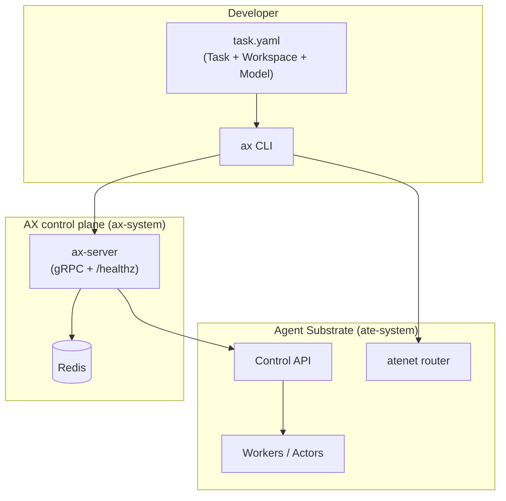

# Google Agent Substrate & AX (Agent Executor)

Exploration notes for running autonomous agent workloads at cluster scale using **[Agent Substrate](https://github.com/agent-substrate/substrate)** and **[AX](https://github.com/google/ax)** (Google’s open agentic orchestration runtime, also called Agent Executor).

> **Branch scope:** This folder exists only on `cursor/google-agent-substrate-946a`. It is intentionally separate from other Cursor branches (for example Qwen fine-tuning or agentic harness work).

---

## The core idea (one sentence)

**Substrate** is the secure, high-density **runtime** that multiplexes many idle “actors” onto fewer workers; **AX** is the **declarative control plane** (kubectl-shaped) that turns agent jobs into isolated sandboxes, warm workspaces, and shared model configuration—without treating agents like stateless microservices or one-shot batch jobs.

---

## Why these projects exist

Traditional platforms map poorly to agents:

| Workload type | Typical assumption | Agent reality |
|---------------|-------------------|---------------|
| Microservice | Stateless, long-lived | Accumulates memory, files, and conversation state |
| Batch job | Run to completion once | Plans, retries, delegates, fans out sub-tasks |
| Untrusted code | Rare | Common (tools, repos, MCP, generated code) |

Agents need **isolation**, **suspend/resume**, **tool/MCP wiring**, **model credentials**, and **observability**—at **large scale** (many concurrent sandboxes). Substrate solves the runtime; AX solves orchestration on top of it.

---

## Agent Substrate: principles

Source: [agent-substrate/substrate](https://github.com/agent-substrate/substrate)

### What it is

- A **low-opinion** execution layer—not an agent SDK. It runs OCI containers with kernel-level isolation (e.g. gVisor, microVMs).
- Maps many **actors** (agents or other stateful apps) onto fewer **workers**, exploiting the fact that agents are **idle most of the time** (heavy multiplexing / oversubscription).
- Built on **Kubernetes** for worker lifecycle (Pods, autoscaling) while adding agent-specific scheduling, routing, and fast suspend/resume.

### Design principles worth remembering

1. **Secure by default** — Zero-trust network and sandbox boundaries; suitable for untrusted agent code and MCP servers.
2. **Stateful lifecycle** — Create, destroy, **suspend**, **resume** with snapshots (RAM + filesystem), targeting sub-second resume at high activation rates.
3. **Framework agnostic** — ADK, LangChain, coding agents, MCP servers, etc. run as standard containers.
4. **Routing** — Traffic reaches the right actor via the substrate router (`atenet`), including request parking when workers are saturated.

### Mental model (glossary)

| Term | Meaning |
|------|---------|
| **Actor** | A running sandboxed instance of an application (often one agent session). |
| **Atespace** | Namespace-like scope for actors, templates, and policies. |
| **ActorTemplate** | Blueprint for how to run an actor (image, resources, etc.). |
| **Worker / WorkerPool** | Physical capacity that hosts one or more actors over time. |

Substrate is **pre-1.0**; APIs and behavior may change significantly.

---

## AX: principles

Source: [google/ax](https://github.com/google/ax)

### What it is

AX is a **high-throughput, declarative orchestrator** for autonomous agent workloads. It runs tasks as sandboxes on Agent Substrate and is designed for **very large** task counts per cluster. If you know Kubernetes, `ax` is intentionally familiar (`apply`, `get`, `watch`, `delete`).

AX is in **heavy development**; expect breaking changes before a stable release.

### Three primitives (everything is YAML)

All resources use API version `ax.io/v1alpha1` and live in an **atespace** (default: `default`).

| Kind | Role |
|------|------|
| **`Task`** | Smallest **isolated execution unit**: image, command, CPU/memory, env, workspace bindings. Cheap to create, suspend, and discard; agents can compose many tasks over time. |
| **`Workspace`** | **Declare once, reuse everywhere**: git repos, MCP servers, skill registries, and optional **`goal`** text so a setup agent can finish environment prep before your command runs. |
| **`Model`** | **Cluster-managed LLM config**: provider, model id, generation params, credentials via Kubernetes secrets—so key rotation and model pins are one `ax apply`, not N task env vars. |

### Task lifecycle (what to watch)

- **`status.phase`** — Coarse state: `Running`, `Suspended`, `Failed`, `Terminating`, etc.
- **Conditions** — Finer detail; use `ax watch` / `ax describe`.
  - `WorkspaceReady` — All workspaces finished setup (stays true).
  - `Ready` — Task is running and workspaces are ready; **wait on this** before assuming the agent can work.

**Suspend / resume** checkpoint actor state on Substrate; **delete** tears down the sandbox and removes the AX record.

### Why AX uses Redis (architecture)

Millions of short-lived tasks as Kubernetes CRDs would stress etcd. AX stores resource state in **Redis**, reconciles with **Agent Substrate** under distributed locks, and exposes a **gRPC** control plane (`ax-server`). Task containers run **`ax-task-runner`**, which bootstraps workspaces and executes the agent command.

---

## How the stack fits together



**Order of operations for a real cluster:**

1. Kubernetes cluster with **Agent Substrate** installed (`ate-system`, Control API reachable).
2. Deploy **AX** control plane (`ax-system`, Redis, images via `ko`).
3. `ax apply` manifests → AX creates Substrate actors and wires workspaces.

---

## How to use (practical path)

### Prerequisites

- Kubernetes + **Agent Substrate** ([install guide](https://github.com/agent-substrate/substrate#quickstart-development))
- `kubectl`, [Go](https://go.dev/doc/install), [`ko`](https://ko.build/) and a registry the cluster can pull from
- Verify Substrate: `kubectl get svc api -n ate-system`

### 1. Install the AX CLI

```bash
go install github.com/google/ax/cmd/ax@latest
# Ensure $(go env GOPATH)/bin is on PATH
```

### 2. Deploy AX

From the `google/ax` repo (or your fork), with Substrate’s Control API reachable:

```bash
make deploy AX_IMAGE_REPO=<your-registry>
```

### 3. Define and run a task

Minimal pattern (from upstream docs):

```yaml
# task.yaml
apiVersion: ax.io/v1alpha1
kind: Workspace
metadata:
  name: golang
spec:
  git:
    - repo: https://github.com/golang/go.git
      branch: "my-fix"
---
apiVersion: ax.io/v1alpha1
kind: Task
metadata:
  name: test
spec:
  workspaces:
    - name: golang
      goal: "Ensure that Go tool chain is available and is built from source"
  debug: true   # enables `ax ssh` into the sandbox
```

```bash
ax apply -f task.yaml
ax watch task test
ax ssh test -- ls -al /workspace
ax suspend task test
ax resume task test
```

Upstream ships `examples/task.yaml` and `./demo.sh` for an end-to-end lifecycle demo.

### Everyday CLI (kubectl-shaped)

```bash
ax apply -f examples/task.yaml
ax get tasks
ax describe task <name>
ax watch task <name>
ax ssh <name>                    # needs spec.debug: true
ax suspend task <name>
ax resume task <name>
ax delete task <name>

ax get workspaces
ax get models
ax ctx                           # how ax reaches the control plane
ax version
```

**Global flags:** `-a / --atespace`, `-n / --namespace` (default `ax-system`), `--context`, `--server` or `$AX_SERVER`.

`ax` follows your active **kube context** (`kubectx`); switch clusters and commands target that cluster’s control plane.

### Substrate-only quickstart (no AX yet)

Useful to understand the runtime before layering AX:

```bash
# In agent-substrate repo — local kind dev flow (see upstream README)
hack/create-kind-cluster.sh
hack/install-ate-kind.sh --deploy-ate-system --credential-provider='{"name":"k8s.io"}'
go install ./cmd/kubectl-ate
kubectl ate create actor my-counter-1 -a ate-demo-counter --template counter
kubectl port-forward -n ate-system svc/atenet-router 8000:80
```

---

## When to choose what

| Goal | Start here |
|------|------------|
| Learn multiplexing, suspend/resume, routing | Substrate **Counter** / **Sandbox** demos |
| Run many declarative agent jobs with git/MCP/skills | **AX** `Task` + `Workspace` |
| Centralize LLM keys and model versions | AX **`Model`** resources |
| Build a custom harness image | AX [Runners](https://github.com/google/ax/blob/main/docs/runner.md) docs |
| Product comparison in this monorepo | Other branches (e.g. harness YAML)—**not** this folder |

---

## Official documentation map

### AX ([google/ax](https://github.com/google/ax))

| Doc | Purpose |
|-----|---------|
| [Concepts](https://github.com/google/ax/blob/main/docs/concepts.md) | Task, Workspace, Model, phases/conditions |
| [Manifests](https://github.com/google/ax/blob/main/docs/manifests.md) | Annotated YAML for all kinds |
| [Sandbox](https://github.com/google/ax/blob/main/docs/sandbox.md) | Boot behavior, metadata server, guest env |
| [Networking](https://github.com/google/ax/blob/main/docs/networking.md) | Reach tasks via atenet |
| [DESIGN.md](https://github.com/google/ax/blob/main/DESIGN.md) | Control plane architecture + gRPC API |
| [Roadmap](https://github.com/google/ax/blob/main/docs/roadmap.md) | Planned milestones |

### Agent Substrate ([agent-substrate/substrate](https://github.com/agent-substrate/substrate))

| Doc | Purpose |
|-----|---------|
| [Architecture](https://github.com/agent-substrate/substrate/blob/main/docs/architecture.md) | Control plane, atelet, networking |
| [API guide](https://github.com/agent-substrate/substrate/blob/main/docs/api-guide.md) | WorkerPools, ActorTemplates, secrets |
| [Glossary](https://github.com/agent-substrate/substrate/blob/main/docs/glossary.md) | Core terms |
| [Threat model](https://github.com/agent-substrate/substrate/blob/main/docs/threat-model.md) | Trust boundaries |

**Blog:** [Agent Executor — distributed agent runtime on Substrate](https://cloud.google.com/blog/products/ai-machine-learning/agent-executor-googles-distributed-agent-runtime)

**Community:** [ate-dev Google Group](https://groups.google.com/g/ate-dev), CNCF Slack `#substrate-users` / `#substrate-dev`

---

## License

Both upstream projects are **Apache License 2.0**. This exploration doc is documentation only; it does not vendor their code.

---

## Changelog (this branch)

| Date | Note |
|------|------|
| 2026-10-05 | Initial capture of Substrate + AX principles and usage paths for AI Exploration. |
